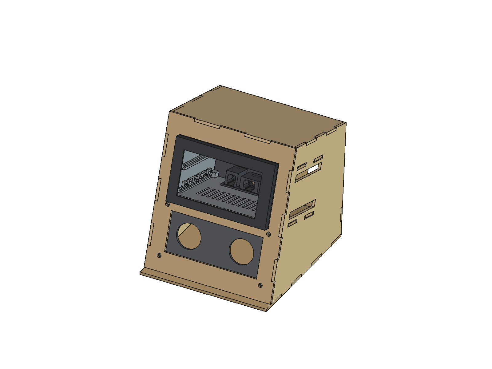

# Godwit centre-stack stand

A free-standing bench stand shaped like a car's centre stack. The Godwit
double-DIN unit ([`../DoubleDin`](../DoubleDin/README.md)) slides into the
upper opening. The two dials sit in the climate-control opening below it,
where a car's heater controls would be. The face leans back 15° like a dash.



Every part is cut from **one ProWood ¼ in × 2 ft × 4 ft sande plywood
panel** (sold as 5.2 mm thick). It uses a ¼ in single-flute O-flute on a
LowRider V4, with a Makita RT0701C as the spindle. The parts fit together
with tabs and slots and are glued.

## Files

| Path | What it is |
|---|---|
| `GodwitCenterStack.FCStd` | The model, the assembly with the enclosure fitted for checking, and the CAM job |
| `build_center_stack.py` | Builds the parts and the assembly from the `Design` spreadsheet, and checks the fit |
| `build_cam.py` | Builds the CAM job and the nest from the `CAM` spreadsheet, checks the toolpath and writes the G-code |
| [`cam/CenterStack_sheet1__1of1_T1-1-4in-O-flute__MAKITA-dial2.nc`](cam/) | **The G-code.** GRBL, metric, the whole sheet in one file |
| `cam/CenterStack_sheet1_nest.dxf` | The same nest as a 1:1 DXF, for other CAM software such as Estlcam. Layers: `CUT`, `RECESS`, `SHEET` |
| `cam/nest.svg` | Where each part lies on the sheet |
| `../exports/Godwit_CenterStack.step` | The assembled stand, without the enclosure |

## Sizes

| | |
|---|---|
| Overall | 250 mm wide × 295 mm deep × 290 mm tall |
| Double-DIN opening | 182 × 104 mm. An ISO 7736 double-DIN unit is 180 × 100 mm. |
| Climate opening | 182 × 78 mm. This is 1.5-DIN (75 mm) plus clearance. It clears both dial boards: the Elecrow CrowPanel 1.28" (Ø48 mm) and the Waveshare 1.8" knob (Ø66 mm). |
| Face lean | 15° back from vertical |

The back is open above a 90 mm rear brace. That leaves room to reach the
Deutsch plugs and the dial cables at the back of the enclosure.

## Parts

| Part | Qty | Flat size (mm) | Joins |
|---|---|---|---|
| Fascia | 1 | 250 × 293 | Box joints to both sides and the top. It carries both openings and the dial-plate bolt holes. |
| Side | 2 | 275 × 289 | Box joints to the fascia, top, base and rear. Slots take the cage decks. Access slots reach the chassis screws. |
| Base | 1 | 250 × 295 | Box joints to both sides and the rear. It has a 15 mm plinth in front of the fascia. |
| Top | 1 | 250 × 211 | Box joints to the fascia and both sides |
| Rear brace | 1 | 250 × 90 | Box joints to both sides and the base |
| Cage deck | 2 | 250 × 140 | Tabs into the sides. Slots take the cheeks. One deck sits under the chassis and one above it. |
| Cage cheek | 2 | 140 × 111 | Tabs into both decks. Slots line up with the chassis's M5 bracket holes. |
| Dial plate, CrowPanel | 1 | 218 × 114 | Bolts on behind the climate opening. Two Ø48.4 push-fit holes. |
| Dial plate, Waveshare | 1 | 218 × 114 | Bolts on behind the climate opening. Two Ø66.6 × 2 mm recesses, each with a 40 × 30 cable hole. |

The decks and cheeks form a plywood double-DIN cage. It holds the chassis
with 0.5 mm clearance all round. The chassis is held the way it would be in
a car: by screws through the cage into its side bracket holes.

## How the joints work with a ¼ in cutter

The sheet is about 5.2 mm thick, but a ¼ in cutter can't make a slot
narrower than 6.35 mm. So no slot is cut to the sheet thickness:

- **Corners are box joints.** The notches open onto the panel edge and are
  much wider than the cutter. The CAM adds a dogbone at every inside corner,
  so the fingers seat fully. There is 0.2 mm of clearance between fingers
  (`Design.fit`).
- **The cage uses offset slots.** Each slot is 7 mm wide. Each joint has two
  tabs, and their slots are offset to opposite sides. The first tab bears
  on one wall and the second on the other, so the panel is held with no play
  even though each slot is wider than the sheet. The slots run 3.5 mm past
  each end of their tab, to clear the cutter's corner radius. The fascia
  sets the depth: the cage butts against its back face.

The joints fit sheets from 5.0 to 5.4 mm thick as they are. **Measure your
sheet with calipers before you cut.** If it is outside that range, set
`Design.thk` and regenerate (see below). At 5.4 mm the box-joint fingers
finish 0.2 mm below the surface, and at 5.0 mm the cage slots have
0.4 mm of play.

## Cutting it

| Setting | Value |
|---|---|
| Tool | ¼ in single-flute O-flute, ¼ in shank |
| Makita RT0701C dial | **2** (12,000 rpm, tachometer-measured) |
| Cutting feed | 3000 mm/min |
| Plunge feed | 600 mm/min |
| Chip load | 0.25 mm (0.010 in) per flute |
| Depth | 6.2 mm through: the sheet, plus 0.5 mm into the spoilboard, plus 0.5 mm for bed variation. Three passes of 2.07 mm. |
| Cutting time | About 17 minutes, plus rapids |

The chip load is within the usual range for a ¼ in O-flute in plywood
(about 0.18–0.30 mm). If the LowRider chatters, lower `CAM.feed_xy`
rather than changing the dial: a higher dial speed with the same feed makes
smaller chips and more heat.

**Setting up:**

1. **Sheet position.** Lay the sheet with its long side along machine Y and
   its corner at X0 Y0, as in `cam/nest.svg`. The parts start 10 mm in
   from the edges.
2. **Hold-down.** The parts have **no holding tabs**, so tape the whole
   sheet down: use painter's tape and CA glue, or double-sided tape under
   every part. The 10 mm margin round the edge is too narrow for screws.
   Small parts (the cheeks, the rear brace and the dial plates) come free
   on the last pass.
3. **Z0** is the top of the sheet at its highest point.
4. **Bed flatness.** The file cuts 0.5 mm below the lowest spot it expects,
   which is set by `CAM.surf_var` = 0.5 mm. If any spot of your bed is lower
   than that below Z0, raise `CAM.surf_var` and re-post. If it isn't,
   parts will stay attached there.
5. **Spindle.** Set the Makita dial to **2** and switch it on before you
   start the file. The file sends `M3 S12000`, which the Makita ignores.
   Switch it off when the file ends.

The file cuts in this order. First it pockets the two Waveshare knob
recesses (2 mm deep). Then it cuts every hole, slot and opening while the
parts are still held by the sheet around them. Last, it cuts the outlines.

## Assembly

1. **Dry-fit everything first.** Sand off any fuzz the O-flute leaves on the
   top face before you test the joints.
2. **Cage.** Stand the two cheeks in the lower deck's slots, then put the
   upper deck on top. In each pair, one tab bears on one slot wall and the
   other on the opposite wall. The decks and cheeks are symmetric, so any
   way round fits.
3. **Lay one side flat** with its inside face up. Fit the cage deck tabs,
   the fascia's edge fingers, the top, the base and the rear brace into
   it. Push the cage forward until it touches the back of the fascia.
4. **Drop the second side on** and work it down over every tab and finger.
5. **Glue.** Once it all goes together, take it apart and glue it back
   together in the same order. Clamp the sides together and check that the
   fascia is square to the base before the glue sets.

**Fitting the Godwit enclosure.** Press an M5 heat-set insert into the
chassis's side bracket pads you plan to use. Use two per side, top and bottom
rows (Z ±35 mm), in any of the six columns. Slide the enclosure in through
the double-DIN opening until its flange sits on the fascia. Then reach
through each side's access slots and drive an **M5 × 12 pan-head screw with
a washer** through the cheek slot into each insert.

**Dials.** Put the plate for your dial boards behind the climate opening.
Bolt it on with **4 × M5 × 20** (or M6) bolts, 8 washers and 4 nyloc nuts.
The holes are 8 mm, so the cutter can profile them; use the washers on both
faces.

- **CrowPanel:** push each dial through its Ø48.4 hole from the front until
  its knob ring stands proud of the fascia. The body is 48 mm across its
  whole length, so the plate holds it by friction. If it is loose, wrap a
  turn of tape round the body. The cable leaves from the back of the body.
- **Waveshare:** seat each knob in its 2 mm recess, fix it with
  double-sided foam tape, and run the cable through the 40 × 30 mm hole
  under it. The position of the knob's USB-C port wasn't known when this
  was drawn. Check that your cable can turn into that hole before you cut
  this plate. The hole size is set by `Design.ws_cw` and `Design.ws_ch`.

Route both dial cables back to the enclosure's USB-C bulkheads through the
open back.

## Changing it

Every size is in the **Design** spreadsheet, and every feed, depth and nest
position is in the **CAM** spreadsheet. Each sketch vertex is bound to the
sheet, so changing the thickness, width, tilt or opening sizes moves the
joints with them. After a change, rebuild the parts, the CAM job and the
files:

```python
import sys; sys.path.insert(0, "/path/to/TrailCurrentGodwit/CAD/CenterStack")
import build_center_stack as cs, build_cam as bc
doc = cs.start()
for p in cs.PARTS: cs.build_part(doc, p)
cs.build_assembly(doc); cs.add_refs(doc); cs.tidy(doc)
print(cs.check_fit(doc))      # no overlaps, every joint touching, 0.5 mm round the chassis
bc.build_sheet()              # the CHECKS rows must all read True
bc.build_job()
print(bc.check_all(), bc.check_edges())
print(bc.post())              # writes the G-code with the Makita dial in its name and header
bc.nest_dxf(); bc.nest_svg(); cs.export_step(doc)
```

Run them in that order. Each step is short, so FreeCAD stays responsive.
Use `bc.post()` rather than the Post Process button. The button writes
the same toolpath, but without the setup notes in the header.

The number of fingers in each box joint is set in `JOINTS` at the top of
`build_center_stack.py`. Change those counts only with a rebuild.

## What has been checked

In the model:
- No two parts overlap.
- Every joint face touches its mate.
- The chassis has 0.5 mm clearance in the cage, and its flange sits on the
  fascia.
- All 12 of the chassis's M5 bracket holes line up with the cheek slots and
  the side access slots.
- Every sketch is fully constrained.

In the toolpath:
- The cutter centre passes within one radius of all 14,880 points sampled
  1 mm apart along every part edge, and nowhere else cuts into a part
  except the dogbones.
- All 232 inside corners are cleared. The same check on the toolpath
  without dogbones reports every one of them 1.315 mm short, which shows
  the check works.
- The G-code is metric. Every plunge runs at 600 mm/min, no rapid goes below
  the sheet surface, and the deepest cut is −6.2 mm.

**Not yet done:** none of this has been cut. Simulate the file first. Then
cut one box-joint corner from scrap to check `fit` before you cut the
sheet.
