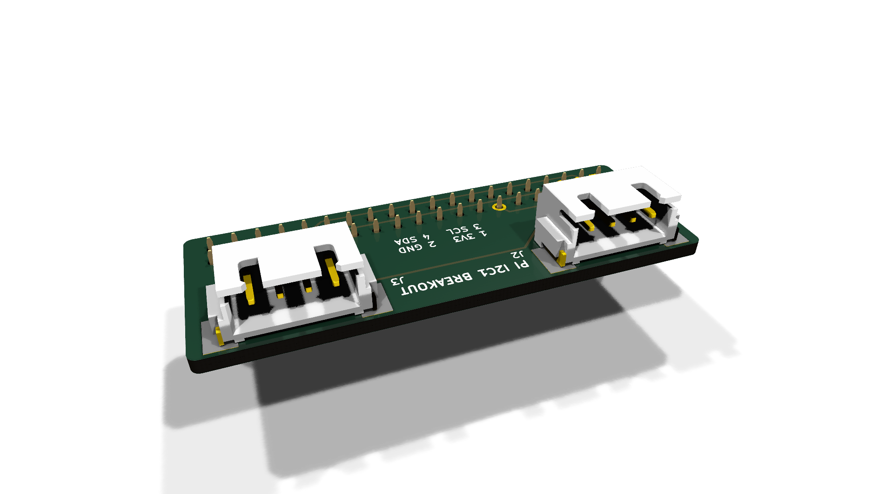

# Pi I2C Breakout

A 54 x 19.7 mm board that plugs straight onto a Raspberry Pi's 40-pin GPIO
header and brings the Pi's I2C1 bus out to two JST-XH 4-pin connectors.

Unlike a HAT, it does not cover the Pi. The board sits over the header and
extends outward past the edge of the Pi. The two side-entry JST-XH connectors
are on that overhang, and their openings face away from the Pi.

It is designed to be **milled on a CNC as a single-sided board**:

- All copper is on the top layer.
- There are no vias and no plated holes.
- Every trace is 0.3 mm wide, with at least 0.4 mm isolation and 0.5 mm from the board edge.

## Fitting

- J1, the 2x20 socket, mounts on the **bottom** side. Its pins pass up through
  the board and are soldered on the top, the copper side.
- Only five header pins have copper: 1 (3V3), 3 (SDA), 5 (SCL), 14 and 34
  (GND). Solder those five. The other 35 pins go through bare 1.0 mm holes,
  which just hold the socket.
- Pin 1 is the square pad, marked `1` on the top silkscreen. It goes to the
  Pi's pin 1 (3V3), at the end of the header away from the USB/Ethernet ports.
- The overhang with the connectors goes outward, over the Pi's edge, not over the board.

## Connectors

J2 and J3 share the same bus (I2C1, `/dev/i2c-1`).

| JST pin | Signal | Pi header pin |
|---|---|---|
| 1 | 3V3 | 1 |
| 2 | GND | 14 (J2), 34 (J3) |
| 3 | SCL | 5 (GPIO3) |
| 4 | SDA | 3 (GPIO2) |

Each connector takes its ground from a different header pin. A single copper
layer cannot join the two grounds without a jumper, and it doesn't need to: the
Pi connects all its GND pins together internally. In the schematic, J3's ground
is the net `GND_PIN34` so that DRC checks the copper as it really is.

The pin names are also printed on the bottom silkscreen under each connector.
The JSTs' outer solder tabs (pins 5 and 6) only hold the housing and are not connected.

- No pull-up resistors are fitted. The Pi already has 1.8 kΩ pull-ups to 3V3 on GPIO2/GPIO3.
- Everything on the bus must use **3.3 V logic**. The 5 V header pins are not connected.
- Enable the bus with `dtparam=i2c_arm=on`.

## Milling files

`manufacturing/cnc/` has what an isolation-milling tool (FlatCAM, pcb2gcode and similar) needs:

| File | Content |
|---|---|
| `pi-i2c-breakout-F_Cu.gbr` | Top copper, viewed from the top (not mirrored) |
| `pi-i2c-breakout-Edge_Cuts.gbr` | Board outline, for the cut-out |
| `pi-i2c-breakout.drl` | All 40 holes, 1.0 mm, Excellon in mm |

- All three files share the same origin: the board's lower-left corner.
- The tightest gap between copper features is 0.4 mm, so the isolation tool
  must cut no wider than 0.4 mm at milling depth.
- There is no copper pour. Every connection, ground included, is a 0.3 mm
  trace, so isolation only follows the traces and the five header pads and JST pads.
- The 35 unused header holes have no copper features, so they are only drilled.
- Copper left between the traces connects to nothing. Leave it or clear it, as your process prefers.

`manufacturing/nextpcb-standard/` has the same board packaged for fab
ordering, in case it is ever ordered rather than milled.

## Parts

| Ref | Part | Manufacturer |
|---|---|---|
| J1 | PPTC202LFBN-RC, 2x20 2.54 mm female socket, through-hole | Sullins |
| J2, J3 | S4B-XH-SM4-TB(LF)(SN), JST-XH 4-pin SMD side entry | JST |

The mating housing is the XHP-4 with SXH-001T-P0.6 crimp contacts.

J1 uses `TrailCurrentSymbolLibrary:RPi_GPIO_Socket_I2C1_Only` and
`TrailCurrentFootprints:RPi_GPIO_Socket_2x20_I2C1_Only`, a socket symbol and
footprint with only the five pins above. They can be reused for any other
single-sided board that only needs I2C1 from the Pi.

## Documentation

- [Schematic (PDF)](../../DOCS/pi-i2c-breakout/pi-i2c-breakout-schematic.pdf)
- [Layout, copper and silkscreen (PDF)](../../DOCS/pi-i2c-breakout/pi-i2c-breakout-layout.pdf)
- Renders: [top](../../DOCS/pi-i2c-breakout/pi-i2c-breakout-top.png),
  [bottom](../../DOCS/pi-i2c-breakout/pi-i2c-breakout-bottom.png)
- 3D model for enclosure fitting: [`CAD/exports/Godwit_PiI2CBreakout.step`](../../CAD/exports/Godwit_PiI2CBreakout.step)
- Check reports: [`erc_report.json`](erc_report.json), [`drc_report.json`](drc_report.json)
